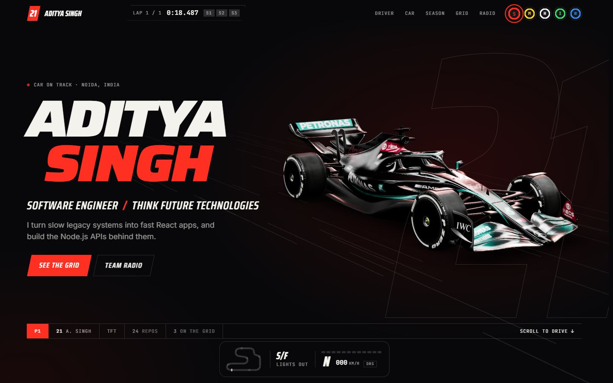
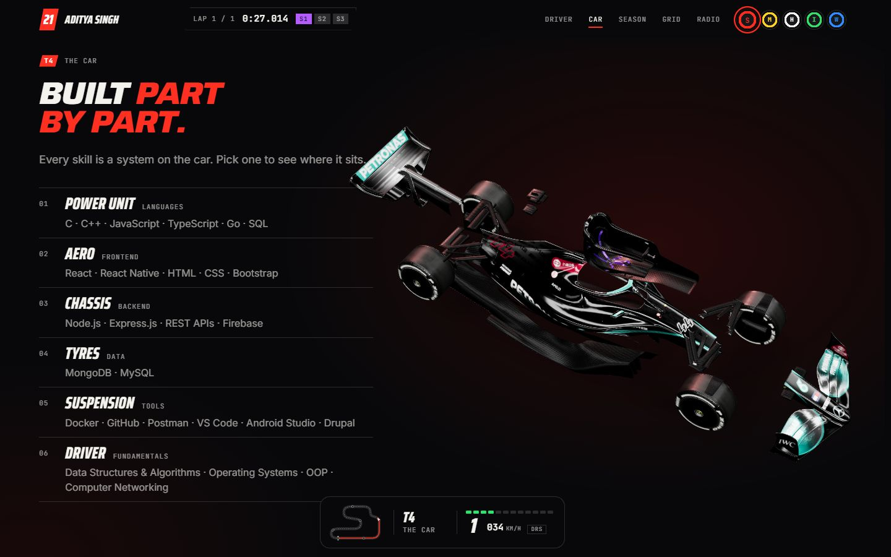
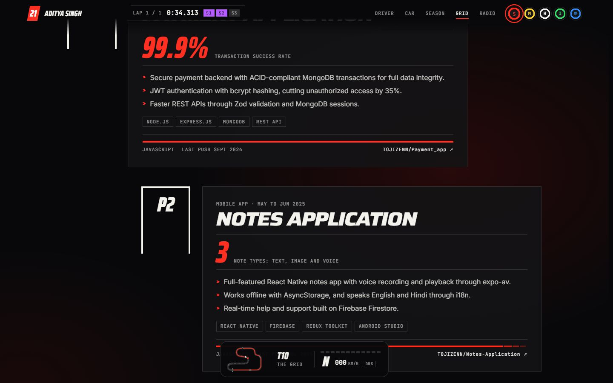
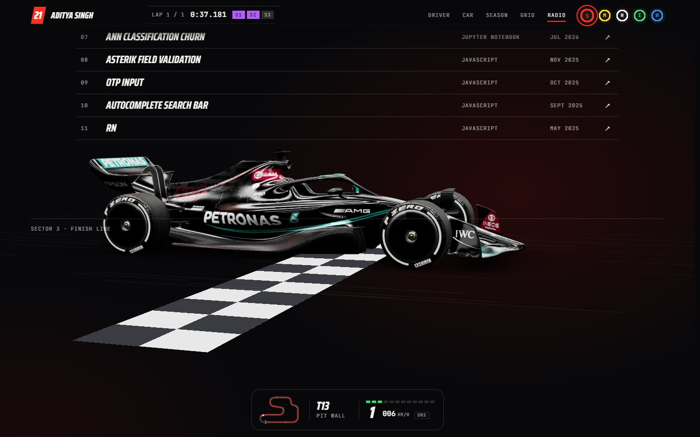
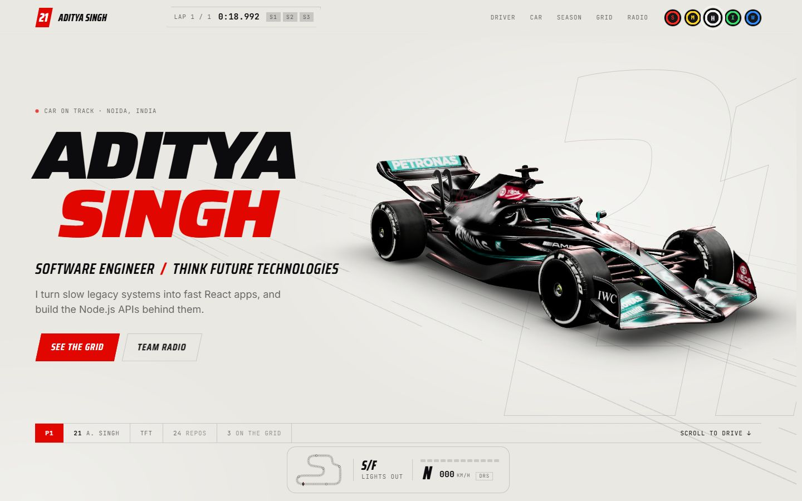
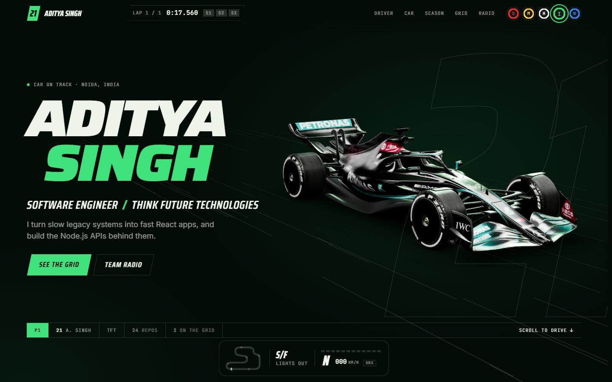
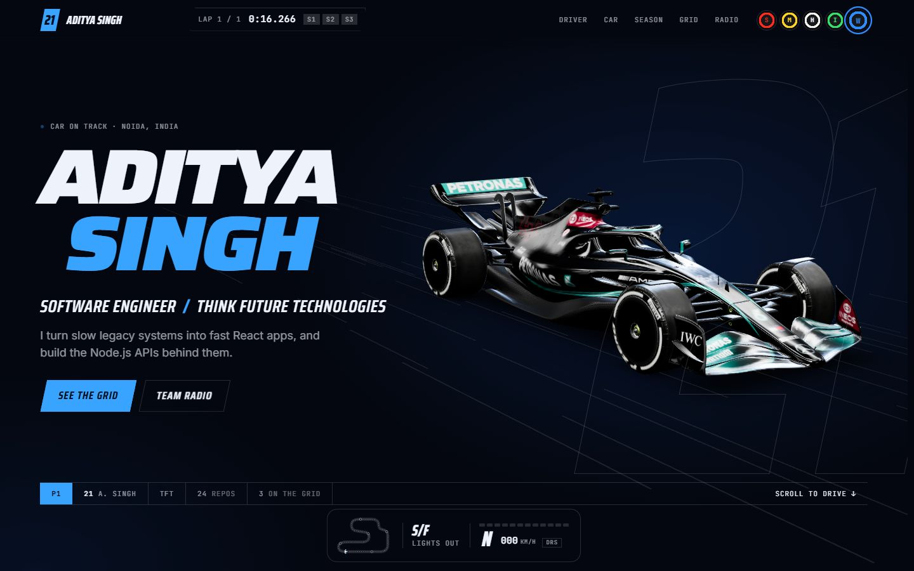

# Sawan Singh · One lap

A portfolio you drive. The page is one lap of a circuit: the start lights go out, a lap timer starts, and scrolling takes car 21 round six corners, from the driver to the pit wall. The car is a detailed 3D model lit like a studio shoot, and it changes pose for every chapter.



| Corner | Chapter | What happens |
| --- | --- | --- |
| S/F | Lights out | Five red lights, then the name, the car at speed, and a timing strip |
| T1 | Driver | The car turns side on. Bio, team, base and academy |
| T4 | The car | The car comes apart from above. Each system is a group of skills, and picking one lights that part |
| T7 | Season | Experience as a results sheet, with promotions shown as steps |
| T10 | The grid | The three resume projects on grid slots, with live details from GitHub |
| T13 | Pit wall | The car crosses a chequered line, then contact and your own lap time |





## Things to try

- **Tyre compounds are the themes.** Soft (scarlet), Medium (yellow), Hard (the daylight scheme), Intermediate (racing green) and Wet (night blue). Changing one is a pit stop: the page, its glow and the light on the car all change. The car keeps its own livery, because it is a textured model.
- **The lap timer is real.** It times your scroll down the page in three sectors. Beat your own best and the sector turns purple. "Another lap" at the bottom goes again.
- **The dash reads your scroll.** Gear, speed and shift lights follow how fast the page is moving. Scroll hard enough and DRS opens.





## Run it

```bash
npm install
npm run dev
```

Then open http://localhost:3002.

```bash
npm run build
npm run start
```

## Change the content

All copy lives in `src/lib/content.ts`: the driver, the car number, stats, the car's systems (skills), the season (experience), projects, certifications and links.

Projects are matched to GitHub by their `repo` name. `src/lib/github.ts` fetches each repository's languages and last push, plus the eight most recently pushed other repositories for the paddock list. It refreshes at most once an hour and falls back to a saved snapshot if GitHub cannot be reached. Set `GITHUB_TOKEN` only if you hit GitHub's rate limit.

The picture shown when the link is shared is `src/app/opengraph-image.jpg`. On Vercel it works as is. On any other host, set `NEXT_PUBLIC_SITE_URL` to the site's address.

## How it works

- **The car** is a real 3D model, `public/models/w13.usdz`, loaded by `src/gl/model.ts`. That file sets it on its wheels, sorts its named parts into the six systems the page talks about, and gives the axles pivots so the wheels turn. Because the parts stay separate, the exploded view and the per-system highlight still work. To use a different car, replace the file and adjust the part names in `RULES`.
- **The lighting** (`src/gl/Scene.tsx`) is a dark studio with long softboxes overhead, the way cars are photographed. They are what put the streaks of light along the bodywork.
- **The camera** (`src/gl/Scene.tsx`) has one pose per chapter and moves between them as the page scrolls.
- **Scroll** (`src/components/Director.tsx`) turns the scroll position into lap progress, the current chapter and a speed.
- **The HUD** (`src/components/Hud.tsx`) is the lap timer, the track map and the dash. `Lights.tsx` is the start sequence and `TyreSwitch.tsx` the theme switch.
- **Themes** are blocks of CSS variables at the top of `src/app/globals.css`. A new compound needs a block there and an entry in `src/lib/race.ts`.
- **Type** is Saira at two widths (wide for headlines, narrow for timing-screen labels), with Inter for reading text.

## Care taken

- With reduced motion on, there are no start lights, no pit-stop wipe and no moving camera: the car is a still picture on the first screen.
- Without WebGL the car is simply absent and the page is complete without it.
- If a machine cannot hold a smooth frame rate, the 3D scene is drawn with fewer pixels, and it is not drawn at all while the car is off screen.
- The phone number on the resume is deliberately not published here.

This is a personal project and is not affiliated with Formula 1 or any team. The car model shows a real team's livery and sponsor logos, which are trademarks of their owners. Credit the model's author here once the source is confirmed.

## Structure

```
src/
  app/            layout, page, global styles and themes, share image
  components/     Director, Hud, Lights, TyreSwitch, Systems, Finish, Reveal, CopyEmail
  gl/             car (the model), Scene (camera, lighting, animation)
  lib/            content (all copy), github (live project data), race (shared state)
```
